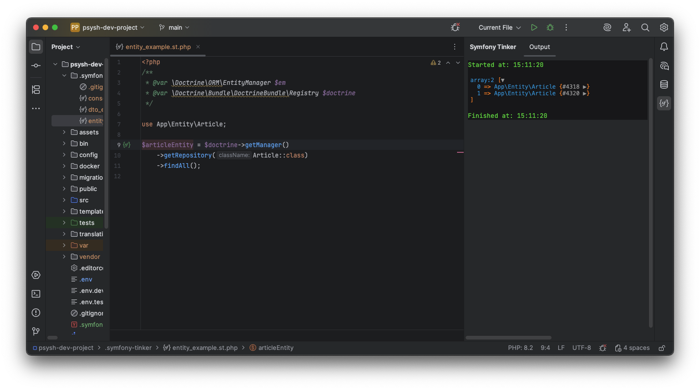
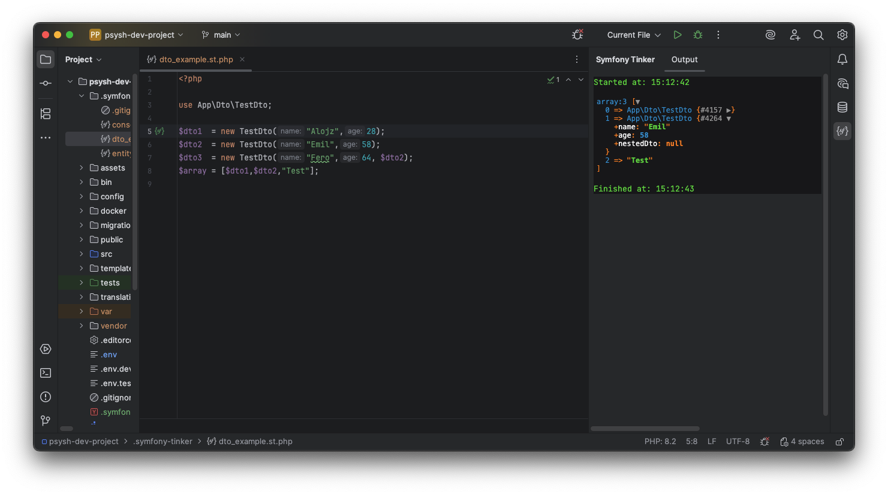

# Symfony Tinker IntelliJ Plugin

<!-- Plugin description -->
Supercharge your workflow: run PHP code instantly in PhpStorm/IDEA, just like with [PsySh](https://psysh.org/) Test snippets on the fly with full access to your Symfony classes—backed by autocompletion, syntax highlighting, and smart error checks from your IDE.
<!-- Plugin description end -->

## Features
TODO
## Credits
- [Roboroads/laravel-tinker](https://github.com/Roboroads/laravel-tinker/) – Major inspiration for this plugin
- [theofidry/PsyshBundle](https://github.com/theofidry/PsyshBundle/)- inspiration for this plugin
- [bobthecow/psysh](https://github.com/bobthecow/psysh) - PHP REPL used under the hood
